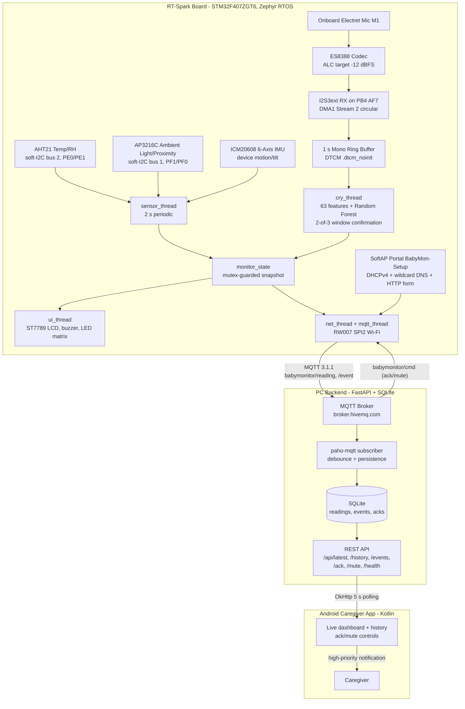
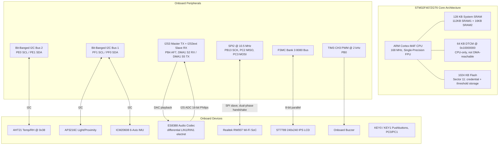
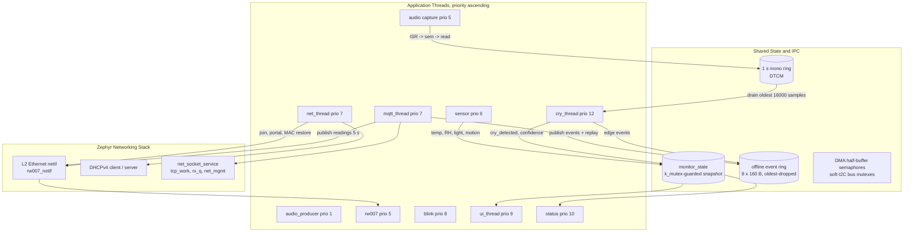
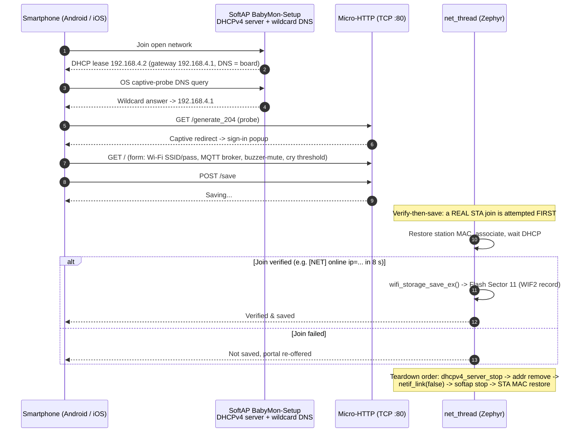
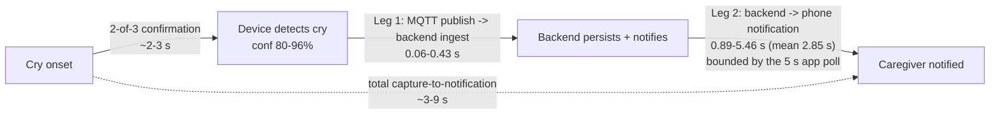

# Project 1: Smart Baby Monitoring System — Formal Laboratory Report

**Mindanao State University - Iligan Institute of Technology**  
**College of Computer Studies**  
**Department of Computer Applications**  
**BCA182: Embedded Systems Programming**

---

### Student and Course Information

| Field | Details |
|---|---|
| **Student Name** | Perch Arnel II Montefalcon |
| **Course and Section** | BCA182 Embedded Systems Programming |
| **Instructor / Evaluator** | Asst. Prof. Paul Rodolf P. Castor, M.Sc. (`paulrodolf.castor@g.msuiit.edu.ph`) |
| **Project Title** | Project 1: Smart Baby Monitoring System (100 Points) |
| **Target Platform** | RT-Thread RT-Spark Development Board (STM32F407ZGT6, ARM Cortex-M4F @ 168 MHz) |
| **Operating System** | Zephyr RTOS v4.4.0 (Preemptive Kernel, Native Sockets, L2 Ethernet Driver) — documented deviation from the prescribed STM32Cube HAL + FreeRTOS toolchain (Section 1.3) |
| **Sensors** | AHT21 temperature/humidity (soft-I2C bus 2, PE0/PE1); AP3216C ambient light/proximity and ICM20608 6-axis IMU (soft-I2C bus 1, PF1/PF0); onboard electret microphone via ES8388 audio codec (I2S3ext RX, 16 kHz mono) |
| **Display** | Sitronix ST7789 v3 240x240 IPS Color LCD (FSMC Bank 3 8080 8-Bit Parallel Bus) |
| **Wireless Transceiver** | Realtek RW007 High-Speed SPI Wi-Fi Module (SPI2 bus, PB13/PC2/PC3), native Zephyr L2 driver |
| **Backend Service** | FastAPI + paho-mqtt + SQLite (Python, host PC) |
| **Mobile Client** | Native Android Application (Kotlin, OkHttp 5 s polling, high-priority cry notifications) |
| **Public Repository** | [https://github.com/Not-to-Shabby/BCA182](https://github.com/Not-to-Shabby/BCA182) |
| **Demonstration** | [Demo video — to be recorded] |

---

## Abstract

This report presents the engineering design, machine-learning pipeline, embedded firmware architecture, and verification of an end-to-end IoT baby-monitoring prototype. The system runs on the STMicroelectronics STM32F407ZGT6 microcontroller under Zephyr RTOS and integrates three onboard environmental sensors, an onboard electret microphone conditioned by an ES8388 audio codec, a captive-portal provisioning workflow, MQTT telemetry, a FastAPI/SQLite backend, and a native Android caregiver application. The defining engineering decision is that baby-cry inference executes entirely on the microcontroller: a 63-feature audio front end (MFCC statistics, log-energy, zero-crossing rate, MFCC deltas, and spectral-shape descriptors) is extracted in pure C on the single-precision hardware FPU, with demonstrated parity against the Python trainer (maximum absolute error 4.77e-07), and classification is performed by an emlearn-exported Random Forest (30 trees, depth 8) compiled to static inline C. A wave-2 training-corpus merge that added distant-room cry recordings doubled the frozen-test cry recall from 0.345 to 0.705 (F1 0.483 to 0.801) while holding the confuser false-positive gate at 9.5 percent.

The firmware is organized as ten statically defined Zephyr threads supervised by an independent window watchdog (IWDG) with per-thread liveness accounting, so that a wedged thread converts into a board reset and self-recovery rather than a silent failure. Wi-Fi provisioning uses a SoftAP captive portal ("BabyMon-Setup") with a DHCPv4 server, wildcard DNS responder, and an HTTP form that captures Wi-Fi credentials, MQTT broker address, buzzer-mute window, and cry-detection threshold; credentials are stored in on-chip Flash Sector 11 only after a verified station join. System verification combines 30/30 host-native Unity unit tests, zero-defect Cppcheck static analysis, 25/25 Android JVM unit tests, 21/21 backend sanity checks, per-thread stack high-water measurements from the Zephyr thread analyzer, a 29-trial end-to-end notification campaign (29/29 delivered, 26 of them real human-triggered cry playbacks), and six documented root-cause analyses of defects discovered and repaired during integration.

---

## 1. Problem Statement and Requirements Traceability

### 1.1 Problem Statement

Infant-monitoring products are dominated by closed, camera-based commercial devices whose cost, cloud dependency, and privacy posture are poorly matched to an educational embedded-systems context. Project 1 requires building an open IoT baby-monitoring prototype that (a) watches the room environment with the RT-Spark board's onboard sensors, (b) listens for baby-cry events through audio classification, and (c) delivers acknowledged, non-flooding alerts to a caregiver's Android phone through a Wi-Fi → backend → mobile-application pipeline, while degrading gracefully under sensor, network, and storage faults.

The course specification explicitly permits a lightweight on-device classifier "if memory and timing measurements demonstrate that it is feasible." We adopted on-device inference as the architectural center of the project for three reasons. First, privacy: no continuous identifiable audio ever leaves the device — only bounded feature windows are processed locally and only compact JSON events traverse the network. Second, latency: classification completes within the 1 s acquisition window on the Cortex-M4F, so alert latency is bounded by the confirmation rule rather than by uplink bandwidth. Third, robustness: a detected cry remains locally annunciated (buzzer, LCD, LED matrix) even when the network is down, with the event queued for later replay.

### 1.2 System Architecture Overview



### 1.3 Documented RTOS Deviation

The assignment sheet prescribes the STM32Cube HAL + FreeRTOS toolchain; this submission uses **Zephyr RTOS 4.4.0** (`framework = zephyr`) instead, for the same documented reason as the author's Laboratories 2–4: framework continuity with the author's verified prior coursework and direct reuse of the native RW007 Wi-Fi driver that was written and graded under Zephyr on this exact board. The full rationale, the FreeRTOS↔Zephyr construct-equivalence table, and the accepted rubric risk are documented in `docs/design.md` §7. Zephyr does not appear on the specification's explicit ban list ("RT-Thread Studio, RT-Thread OS, Arduino, ESP-IDF, or an RT-Thread-dependent driver stack"), and the engineering substance the firmware criterion assesses — correctly scheduled concurrent threads, documented synchronization, local status and controls, and *measured* memory and timing — is delivered natively and evidenced in Sections 3 and 8.

### 1.4 Requirements Traceability Matrix

The matrix maps the implementation to the specification's assessment criteria (100 points) and minimum-evidence test areas.

| Req ID | Specification Line (Points) | Implementation Solution | Verification Module |
|---|---|---|---|
| **REQ-01** | *System design and component justification* (15): full onboard inventory; external-module justification; pinout and interface design | Full onboard inventory used; **no external microphone module** — the spec's assumption that mic input is absent is contradicted by schematic sheet 9/10: the onboard electret M1 is wired differentially into ES8388 LIN1/RIN1. W25Q128 SPI flash is excluded (documented): it shares SPI2 with the RW007 driver. AHT21 (not AHT10) identified on soft-I2C bus 2 (PE0/PE1) by empirical boot-time address scan plus the official RT-Thread SDK demo. | `docs/design.md` §3, `docs/project-plan.md` §3 |
| **REQ-02** | *Firmware* (25): correctly scheduled concurrent tasks | Ten statically defined Zephyr threads with fixed priorities (Section 3.1); deadline-resync periodic sleeps; measured per-thread stack high-water marks. | Zephyr thread analyzer dump (Section 8.3) |
| **REQ-03** | *Firmware* (25): synchronization | `k_mutex` (monitor state, I2C buses, SD/FatFs, event ring), `k_msgq`/rings (audio, events), DMA half-buffer ISR-to-thread handoff, atomics for cross-thread connection flags. | `src/*.c`, code walkthrough (Section 3.3) |
| **REQ-04** | *Firmware* (25): local status/controls | ST7789 differential dashboard (readings, state banner, mute countdown, portal flag); TIM3 CH3 (PB0) 2 kHz PWM buzzer; LED-matrix state tint; KEY0 acknowledge (60 s mute) and 8 s reconfigure dialog; KEY1 test-alert toggle. | `src/ui_dashboard.c`, `src/buzzer.c`, `src/buttons.c` |
| **REQ-05** | *Baby-cry ML pipeline* (20): functional pipeline, appropriate labels and thresholds | 63-feature front end (feature-set v2), emlearn rf30x8 forest, cry vote-share threshold (trainer operating point 73 percent; firmware default 80 percent, portal-adjustable 10–99 percent), 2-of-3 consecutive 1 s window confirmation. | `src/audio_features.c`, `src/cry_task.c`, `include/cry_model.h` |
| **REQ-06** | *Baby-cry ML* (20): independently tested classifier; kept splits; provenance | Frozen-test protocol: 40 ESC-50 crying-baby clips + 40 non-cry clips evaluated exactly once, never trained on; tuning on VAL only; md5 content-hash dedup; dataset provenance and license table (Section 4.1). | `ml_model/model_report.txt`, confusion matrix (Section 4.4) |
| **REQ-07** | *Baby-cry ML* (20): reasoned deployment | On-device inference quantified: 1 s compute window on 1 s of audio after the Section 7.1 optimization; model header 1,276,170 B within the 1.5 MB budget; Flash 34.2 percent total. | Section 4.5, Section 8.4 |
| **REQ-08** | *Backend, connectivity, mobile app* (20): end-to-end data flow; timely alerts; history | RW007 → Zephyr L2 Ethernet → DHCPv4 → MQTT 3.1.1 publish/subscribe; FastAPI + SQLite backend; OkHttp 5 s polling Android app with high-priority cry notifications and history. | Sections 5, 6; 29-trial campaign (Section 8.5) |
| **REQ-09** | *Backend* (20): database of readings, events, status, acks | SQLite schema covering timestamped readings, classified events, device status, and alert acknowledgements; `/api/ack` and `/api/mute` write the command path back to the device. | `backend/app.py`, `backend/sanity_check.py` |
| **REQ-10** | *Backend* (20): debounced notifications; stale-data handling | Backend event edge-debounce (cry on/off + `allclear` transitions); app distinguishes current vs. stale data from the last successful poll time; device fault states published on `babymonitor/event`. | `backend/app.py`, `android_app/` |
| **REQ-11** | *Testing, reliability, safety* (15): ≥20 unseen cry + 20 non-cry clips; confusion matrix, precision, recall, F1, false positives | 40 frozen-test cry and 40 non-cry windows (200 windows per class including multi-window clips); full confusion matrix, per-class precision/recall/F1, confuser false-positive table. | Section 4.4, `ml_model/model_report.txt` |
| **REQ-12** | *Testing* (15): ≥10 end-to-end trials with capture-to-notification time | 29/29 delivered trials (26 real human-triggered cry playbacks + 3 synthetic controls), per-leg latency measured with a documented clock-offset method. | Section 8.5 |
| **REQ-13** | *Testing* (15): live timestamped sensor readings with controlled changes | Live AHT21 temperature/humidity, AP3216C light, ICM20608 device-motion readings at 2 s period; hysteresis thresholds (16.0/32.0 °C, 80 percent RH) unit-tested at every boundary. | `src/sensor_task.c`, `test/test_baby/` |
| **REQ-14** | *Testing* (15): real-time firmware evidence — periods, scheduling, heap, stack margins | Zephyr thread analyzer high-water dump at 89 s uptime for 16 threads; static allocation throughout (no runtime heap for threads); memory budget table. | Section 8.3, Section 8.4 |
| **REQ-15** | *Testing* (15): connectivity resilience and fault recovery | Link-loss supervisor with exponential backoff (2→30 s cap); offline event ring with replay on reconnect; IWDG + per-thread liveness converting wedges into self-recovery; documented wedge incident (Section 7.2). | Sections 5.4, 7.2, 8.6 |
| **REQ-16** | *Testing* (15): UI/controls — history, stale data, acknowledgement, normal/alert/fault states | App history list, stale-data indication, ack/mute controls; device dashboard NORMAL/ALERT/FAULT banner states with mute countdown. | Section 6, `src/monitor_state.c` |
| **REQ-17** | *Documentation and reproducibility* (5) | Reproducible PlatformIO build (`pio run`, `pio test -e native`, `pio check`), README build/flash instructions, tagged submission, no committed secrets (`secrets.h` and `backend/*.env` gitignored). | Repository, `platformio.ini` |

---

## 2. Hardware Architecture and Bus Interconnects

### 2.1 Microcontroller Architecture

The system runs on the RT-Thread RT-Spark development board ("Spark-1", HW rev 1.1), featuring the STMicroelectronics STM32F407ZGT6 microcontroller:

* **Core**: 32-bit ARM Cortex-M4F at 168 MHz with single-precision hardware FPU (FPv4-SP). The Section 7.1 analysis shows why single-precision execution is not merely an optimization here but a scheduling-structural requirement.
* **Memory**: 1024 KB Flash, 192 KB SRAM (112 KB SRAM1 + 16 KB SRAM2), and 64 KB Data-TCM (DTCM/CCM) at `0x10000000`. DTCM is not DMA-reachable, a property the memory budget exploits deliberately (Section 8.4).
* **Buses**: Multi-AHB matrix, DMA1/DMA2 controllers, FSMC parallel memory controller, SPI/I2S peripherals.

### 2.2 Hardware Subsystem Bus Interconnect Architecture



### 2.3 Audio Capture Chain

Cry audio is captured entirely by hardware already on the board — no external microphone module is required:

1. **Transduction**: The onboard electret capsule (M1, BA012AP42) drives the ES8388's differential LIN1/RIN1 inputs, rejecting common-mode supply noise.
2. **Conditioning**: The ES8388 input chain runs its automatic level control (ALC) with a target of **-12 dBFS** (ADCCONTROL11 = 0x80), keeping the digitized signal loud but with measured **zero clipped samples** at both idle and loud-playback stress; a live per-second RMS health line on the serial console (including a `clip=` counter) makes headroom observable during operation.
3. **Digitization**: ADCCONTROL4 = 0x0C selects 16-bit Philips I2S format. SPI3 runs as I2S master transmitter; **I2S3ext** (the receive-only extension block per RM0090 §28.5) runs as slave receiver on **PB4 remuxed to AF7** (Section 7.3).
4. **Transport**: DMA1 Stream 2, Channel 2 (per ST AN4031 request mapping) moves 16-bit words from `I2S3ext->DR` into a 512-word circular buffer, with half/full transfer interrupts splitting stereo pairs.
5. **Buffering**: The right channel (the louder leg under ALC) is decimated to mono into a 1 s ring buffer (16,039 samples) placed in DTCM via the `.dtcm_noinit` section — CPU-access-only, which the capture ISR writes and `cry_thread` reads, and which frees main SRAM for the network stack (Section 8.4).

### 2.4 Complete Hardware Interconnect Netlist

```text
========================================================================================
RT-THREAD RT-SPARK BOARD (STM32F407ZGT6) PERIPHERAL WIRING NETLIST (PROJECT 1 SUBSET)
========================================================================================
Subsystem         Pin    MCU Mode          Electrical Function
----------------------------------------------------------------------------------------
AHT21 Temp/RH     PE0    GPIO OD (Pull-Up) Soft-I2C Bus 2 Clock (SCL) - dedicated bus
                  PE1    GPIO OD (Pull-Up) Soft-I2C Bus 2 Data  (SDA)
----------------------------------------------------------------------------------------
AP3216C / IMU     PF1    GPIO OD (Pull-Up) Soft-I2C Bus 1 Clock - AP3216C + ICM20608
                  PF0    GPIO OD (Pull-Up) Soft-I2C Bus 1 Data  - AP3216C + ICM20608
----------------------------------------------------------------------------------------
Audio Codec       PB4    AF7 (I2S3ext_SD)  ES8388 ADC serial data INTO MCU (RX)
                  (SPI3/I2S3 audio pins per RT-Spark schematic sheets 9/10)
----------------------------------------------------------------------------------------
Wi-Fi Transceiver PB13   SPI2_SCK (AF5)    Realtek RW007 High-Speed SPI Clock (10.5 MHz)
                  PC2    SPI2_MISO (AF5)   Realtek RW007 Master-In-Slave-Out
                  PC3    SPI2_MOSI (AF5)   Realtek RW007 Master-Out-Slave-In
                  PF10   GPIO Output       RW007 SPI Chip Select (Active LOW)
                  PG15   GPIO Output       RW007 Hardware Reset
                  PG11   GPIO Input (PU)   RW007 Interrupt / Ready Line
----------------------------------------------------------------------------------------
IPS LCD Display   PD0/1, PD14/15, PE7..10  FSMC_D0..D7 (AF12)  8-Bit Data Bus
                  PD4    FSMC_NOE (AF12)   ST7789 Read Enable
                  PD5    FSMC_NWE (AF12)   ST7789 Write Enable
                  PG10   FSMC_NE3 (AF12)   ST7789 Chip Select (Bank 3)
                  PD13   FSMC_A18 (AF12)   ST7789 Command/Data Select
----------------------------------------------------------------------------------------
Alerts / Input    PB0    TIM3_CH3 (AF2)    Buzzer, 2 kHz PWM alarm tone
                  PF12   GPIO Output       Onboard red RGB LED (liveness blink)
                  PC0    GPIO Input (PU)   KEY0 (acknowledge / Wi-Fi reconfigure)
                  PC1    GPIO Input (PU)   KEY1 (test-alert toggle / dialog cancel)
----------------------------------------------------------------------------------------
Console Debug     PA9    USART1_TX (AF7)   ST-LINK V2.1 Virtual COM Port (115200 baud)
                  PA10   USART1_RX (AF7)   ST-LINK V2.1 Virtual COM Port (115200 baud)
========================================================================================
Excluded resource: W25Q128 SPI flash (CS PB12) - shares SPI2 with the RW007 driver;
driving both would create a bus conflict. Present-but-unused per the spec's
component-inventory exclusion rule.
========================================================================================
```

---

## 3. Real-Time Software and Concurrency Architecture (Zephyr RTOS)

### 3.1 Thread Execution Allocation

All application threads are statically defined (`K_THREAD_DEFINE` or static stacks in DTCM); no thread is created from the heap. Periodic threads sleep on absolute deadlines and resynchronize after a miss instead of bursting.

| Thread | Priority | Stack | Period / Trigger | Responsibility |
|---|---|---|---|---|
| `audio_producer` | 1 | 2048 B | 1 ms poll | ES8388 DAC PCM staging; deliberately outranks capture so a long playback feed cannot starve the DMA staging buffers. |
| `audio capture` | 5 | 2048 B | DMA half-buffer ISR | I2S3ext RX servicing, ALC/RMS level metering, mono ring maintenance. |
| `rw007` | 5 | 2560 B | PG11 IRQ / command | Native RW007 SPI driver: dual-phase handshake, frame exchange into the Zephyr net stack. |
| `sensor` | 6 | 2048 B | 2000 ms | AHT21 + AP3216C + ICM20608 acquisition; decision-logic refresh under the state lock. |
| `net_thread` | 7 | 4096 B (DTCM) | 1 s supervision | Wi-Fi join supervisor with exponential backoff; SoftAP captive portal branch; link-loss handling. |
| `mqtt_thread` | 7 | 4096 B (DTCM) | 200 ms service loop; 5 s publish | MQTT 3.1.1 client: readings publish, event publish, `babymonitor/cmd` subscription, offline event ring replay. |
| `blink` | 8 | 1024 B | 500 ms | Onboard red LED liveness toggle. |
| `ui_thread` | 9 | 2048 B | 100 ms | Differential LCD redraw, debounced buttons, buzzer drive, LED-matrix state tint — all on a local snapshot copy under the state mutex. |
| `status` | 10 | 2048 B | 1000 ms | Console heartbeat every 5 s; thread-analyzer stack dump every 30 s. |
| `cry_thread` | 12 | 4096 B | 1 s window | Feature extraction (63 features) + forest inference + 2-of-3 confirmation + event publishing. |

Zephyr system threads visible in the measurement below (`net_socket_service`, `net_mgmt`, `rx_q[0]`, `tcp_work`, `sysworkq`, `idle`, `ISR0`) complete the sixteen-thread census.

### 3.2 Thread and Data-Flow Architecture



### 3.3 Synchronization and Interrupt-to-Task Coordination

* **`k_mutex`**: one mutex guards the `monitor_state` snapshot (producers: `sensor`, `cry_thread`, `net`, `mqtt`; consumers: `ui`, `status`, `mqtt`); one mutex per bit-banged I2C bus (PF1/PF0 and PE0/PE1 are independent buses, each serialized separately); one mutex guards the MQTT offline event ring.
* **ISR-to-thread**: the DMA1 Stream 2 half/full-transfer ISR signals the audio-capture thread; the ISR performs only flag clearing and length bookkeeping, never feature math.
* **Atomics**: the MQTT connected flag is an `atomic_t` because other threads poll it without taking a lock.
* **Snapshot discipline**: `ui_thread` copies the state snapshot under the mutex and performs all LCD and register I/O *outside* the lock, so slow display traffic never delays producers.

### 3.4 Independent Watchdog with Per-Thread Liveness Supervision

A single fed watchdog detects only a globally dead CPU. The firmware instead arms the independent watchdog (IWDG) with a 16 s timeout and couples it to a per-thread liveness registry (`src/watchdog.c`): supervised threads report progress by name into 4 s feed windows, and `watchdog_feed_check()` **withholds the IWDG feed** if any registered thread has not reported within its window. A wedge anywhere therefore produces a bounded board reset rather than an indefinite hang, and the boot log's reset signature documents the self-recovery. The incident in Section 7.2 shows this mechanism firing in production during the first portal verify-join.

---

## 4. Machine Learning and Signal Processing Pipeline

### 4.1 Dataset Provenance and Frozen Evaluation Protocol

The corpus was assembled from public research datasets with documented licenses and md5 content-hash deduplication against every existing split:

| Corpus | Role | License |
|---|---|---|
| donateacry-corpus (sha `6baf5ac`) | Close-mic cries (wave 1) | ODbL 1.0 |
| ESC-50 (sha `33c8ce9`) | Frozen test clips + confuser categories + augmentation noise pool (folds 1–3 only) | CC BY-NC 3.0 |
| SICCD; CSIBE (Sakha & Ameri 2026, DOI 10.5281/zenodo.21848098; Kertesz 2018, DOI 10.5281/zenodo.1243714) | Wave-2 cries incl. 960 CSIBE AIBO room cries | CC BY 4.0 |
| hoyyu_icd incl. CryCeleb subset (4,552 distant-room cries) | Wave-2 cries — **training only**, research-use treatment; no raw audio redistributed | No license field (public research artifact) |

**Frozen protocol (immutable across all tuning waves):** the test split is 40 ESC-50 crying-baby clips + a frozen fold-5 non-cry subset, evaluated exactly once per shipped model; no ESC-50 crying-baby clip is ever trained on; all threshold and architecture tuning happens on VAL only. A dedicated **confuser split** (160 clips / 800 windows: chainsaw, helicopter, rooster, siren) acts as the false-positive gate — these categories are in no training split by protocol.

**Wave-2 merge:** wave 1 could only *augment* close-mic cries to *look* distant; wave 2 added corpora that *contain* the deployment domain — 61,448 candidate clips scanned, 35,650 eligible after md5 dedup and 1 s minimum-length filtering (23,110 dropped as short, 2,688 as intra-candidate duplicates, 0 collisions with the frozen test/confuser sets), including 17,730 new cry clips and 43,718 new domestic non-cry clips. The merged training set (before augmentation) is 16,486 cry / 18,031 non-cry clips; with wave-level augmentation the forest trains on 266,088 windows (163,471 cry / 102,617 non-cry).

### 4.2 Feature-Set v2: 63 Features Extracted On-Device in Pure C

Each non-overlapping 1 s window (16,000 samples, 16 kHz mono) is parameterized as follows: 512-point Hann-windowed frames at 256-sample hop (61 frames), 512-point radix-2 DIT FFT, power spectrum, 40-band mel filterbank with log compression, 13-coefficient orthonormal DCT-II, first-order frame deltas, and window-level aggregation.

| Index block | Features | Count |
|---|---|---|
| 0–12 / 13–25 | MFCC mean / population std | 26 |
| 26–27 | log-energy mean / std | 2 |
| 28 | zero-crossing-rate mean | 1 |
| 29–41 / 42–54 | MFCC-delta mean / std | 26 |
| 55–56 | log-energy-delta mean / std | 2 |
| 57–62 | spectral centroid, 85 percent rolloff, flatness (mean / std each) | 6 |
| | **Total** | **63** |

The identical front end exists in Python (`extract_features.py`, feature-set v2) and in firmware C (`src/audio_features.c`, ~9.5 KB static DTCM workspace). **Parity contract:** `test/test_features/` compiles the *real* firmware source into the host test binary and compares it against Python golden vectors — 7/7 tests pass with maximum absolute feature error **4.77e-07** (float32 arithmetic noise). This guarantees the deployed model consumes numerically the same features the trainer computed.

### 4.3 Classifier, Threshold, and Confirmation Rule

Three candidates were trained and swept on VAL (threshold swept 40–90 with a 10 percent confuser-FP gate): rf16x7 (val cry F1 0.787), rf24x6 (0.777), and **rf30x8 (0.830)**. The selected model is a Random Forest of **30 trees, maximum depth 8, class_weight=balanced**, exported by emlearn 0.23.2 to a 1,276,170-byte static inline-C header (`include/cry_model.h`) — within the 1.5 MB header budget and requiring zero dynamic memory at inference.

* **Training operating point**: 73 percent cry vote share (≥22/30 trees), selected by the VAL sweep under the confuser gate.
* **Firmware runtime threshold**: default **80 percent**, adjustable 10–99 percent from the portal and remotely, persisted in the Flash Sector 11 record (magic `WIF2`, 176 bytes) alongside Wi-Fi and broker credentials; raising the shipped default trades a little recall for a materially lower false-alarm rate in continuous operation.
* **Confirmation rule (spec)**: a window is cry-positive when the majority vote calls CRY *and* cry vote share ≥ threshold; the alarm fires only when **≥ 2 of the last 3 consecutive 1 s windows** are positive. Detection therefore adds ~2–3 s from cry onset, which the notification-use-case latency budget absorbs comfortably (Section 8.5).
* The rule is implemented in pure C (`src/baby_logic.c` + `src/cry_task.c`) with no RTOS includes and is exercised by 23 host Unity tests.

### 4.4 Frozen-Test Results

The shipped model was evaluated on the frozen test split exactly once at the training operating point:

```text
Confusion matrix (rows = truth [noncry, cry], cols = prediction [noncry, cry]):
                 pred noncry   pred cry
  true noncry |        189 |       11
  true cry    |         59 |      141
class     precision     recall         f1  support
noncry        0.762      0.945      0.844      200
cry           0.928      0.705      0.801      200
accuracy: 0.825
(energy baseline on FROZEN TEST: noncry FP 165/200, cry recall 192/200)
```

**Confuser false positives** (800 windows, gate ≤ 10 percent): chainsaw 10/200 (5.0 percent), helicopter 0/200 (0.0 percent), rooster 45/200 (22.5 percent), siren 21/200 (10.5 percent) — **total 76/800 = 9.5 percent**. Clip-level view: 38/40 cry clips have ≥1 positive window and 33/40 have ≥2 (consistent with the 2-of-3 rule); 5/40 non-cry clips have ≥1 false-positive window.

The naive log-energy baseline puts the result in context: it achieves cry recall 192/200 but at 165/200 non-cry false positives — useless as a monitor. The trained forest gives up 51 cry windows of recall to remove 154 false positives.

### 4.5 Wave-2 Domain-Shift Analysis

The v6 shipped model (rf16x7, T=75) measured frozen cry recall 0.345, F1 0.483 — the wave-1 diagnosis was that the model lacked *distant/room* cry audio, not more synthesis. Wave 2 fixed it inside the frozen protocol:

| Metric (frozen test) | v6 rf16x7 T=75 | v7 rf30x8 T=73 |
|---|---|---|
| Cry precision / recall / F1 | 0.802 / 0.345 / 0.483 | **0.928 / 0.705 / 0.801** |
| Non-cry FP | 17/200 (8.5 percent) | **11/200 (5.5 percent)** |
| Accuracy | 0.630 | **0.825** |
| Confuser FP (gate ≤ 10 percent) | 0.096 | **0.095** |
| Cry clips with ≥2 positive windows | 19/40 | **33/40** |
| Model header / firmware flash | 332,196 B / 167,436 B | 1,276,170 B / 338,116 B (P3 build) |

Two protocol-preserving repairs were needed: (1) **domain-aware augmentation routing** — close-mic donateacry cries keep the full degrading recipe (reverb/lowpass/real-noise) while already-distant wave-2 cries get only a mild noise/volume recipe, because double-degrading domain-matched audio blurred the cry template into the siren/rooster confuser region; (2) **boundary weighting** — sample weight x3.0 on the 18 ESC-50 training categories nearest the (never-trained-on) confuser categories, pushing the non-cry boundary outward via their nearest in-train relatives. The naive full inclusion had broken the confuser gate (0.185 at T=75); these two levers restored it to 0.095.

### 4.6 Audio Front-End Health: ALC and Level Metering

The ES8388 input chain runs ALC with a -12 dBFS target (attack 416 us, decay 820 us) and a peak limiter. Verification is continuous rather than one-shot: a per-second RMS health line on the serial console reports left/right RMS and a clip counter, measured at **zero clipped samples** both at idle and during loud playback stress. This matters because MFCC statistics are sensitive to hard clipping, and a monitor that will run unattended for hours must not silently develop input-path gain faults.

---

## 5. Connectivity, Provisioning Portal, and Resilience

### 5.1 RW007 as a Native Zephyr L2 Ethernet Interface

The Realtek RW007 module is driven by the native SPI2 driver developed in Laboratory 3 (`src/rw007_wifi.c`): dual-phase 16-byte header handshakes with 32-bit magic words, a falling-edge ready handshake on PG11, and full-duplex SPI DMA data phases. The driver registers as a Zephyr **L2 Ethernet network interface** (`src/rw007_netif.c`), so DHCPv4, ARP, DNS, sockets, and the in-tree `CONFIG_MQTT_LIB` client operate on top of it unchanged. The device leases an address via DHCPv4, publishes compact JSON to `babymonitor/reading` (5 s period) and `babymonitor/event` (edge-triggered: `cry on`, `cry off`, `allclear`, fault transitions), and subscribes to `babymonitor/cmd` at QoS 1 for `{"cmd":"ack"}` and `{"cmd":"mute","sec":N}` (N clamped 0–3600 s; the on-device KEY0 acknowledge remains the fixed 60 s window). An 8-slot offline event ring (oldest-dropped) queues events during outages and replays them on reconnect.

### 5.2 Captive Portal Provisioning Flow



The portal form also carries a **cry confidence threshold** control (10–99 percent, default 80) and **buzzer-mute presets** (30 min / 1 h / 2 h / 8 h) applied through the same state-mirror path as the remote MQTT mute. The 300 s portal window (longer than Laboratory 3's) reflects the larger form. Portal ownership is published as `portal_active` so the LCD shows an AP flag during provisioning.

### 5.3 Verify-Then-Save and KEY0 Reconfiguration

Credentials are **never persisted unverified** — the LAB_3 rule. A `POST /save` triggers a real station join; only a join that reaches a DHCP lease writes all four values to Flash Sector 11. First-boot devices with no stored record open the portal immediately; saved-credential devices that exhaust a 3-attempt join burst re-open it; online-history devices re-offer the portal after every 5th failed burst. KEY0 (held while no unmuted alarm sounds) launches an interactive **8 s LCD confirmation dialog** (`[KEY0] CONFIRM & RESET` / `[KEY1] CANCEL & RESUME`); confirmation clears the stored record and relaunches the hotspot, so the device can never end up permanently unreachable.

### 5.4 Link-Loss Supervision and Reconnect Behavior

While online, a 1 s supervisor polls the link; on loss it drops the carrier, stops DHCP, publishes `net_online=false`, and retries the join burst with exponential backoff (2, 4, 8, 16, 30 s, capped at 30). Events raised offline are queued in the 8-slot ring and replayed on reconnect. The IWDG liveness layer (Section 3.4) sits above all of this and guarantees that even a wedged (as opposed to merely disconnected) network stack self-recovers, as demonstrated in Section 7.2.

---

## 6. Backend Service and Android Companion Application

### 6.1 PC Backend (Phase P5)

The backend (`backend/app.py`) is a single FastAPI service with two planes:

* **MQTT ingestion** (paho-mqtt): subscribes to the broker (live-tested against the public `broker.hivemq.com`), debounces device events, and persists everything to SQLite (WAL mode).
* **REST API**: `GET /api/latest`, `GET /api/history`, `GET /api/events`, `POST /api/ack`, `POST /api/mute`, `GET /api/health`. Ack and mute map onto QoS-1 publishes to `babymonitor/cmd`, returning success only when the broker PUBACK arrives (HTTP 503 otherwise, so the app can render an honest error state).

A 21-assertion sanity suite (`backend/sanity_check.py`) validates the schema, ingestion, and endpoint contracts; all 21 pass.

### 6.2 Android Application (Phase P6)

The Kotlin application (`android_app/`, package `com.msuiit.bca180.babymonitor`) targets the spec's minimum surface:

* **Live dashboard**: room temperature, humidity, ambient light, cry-detection state, and device/network condition, refreshed by OkHttp polling every **5 s** (`DashboardPoller.PERIOD_MS = 5000`).
* **High-priority cry notifications** (`CryNotifier`): a clearly labeled notification per confirmed cry event.
* **History**: chronological event and reading history from `/api/events` and `/api/history`.
* **Acknowledgement and controls**: ack and mute actions POSTing to `/api/ack` and `/api/mute`.
* **Stale-data and error handling**: the interface distinguishes current from stale data by last successful poll and renders API errors without freezing.

**Contract hardening**: the P5/P6 interface suffered a real mismatch (bare-array vs. wrapped-list responses and `on` vs. `on_flag` field naming; Section 7.6), fixed backend-side with contract aliases so both surfaces share one schema. Cleartext HTTP to the LAN backend is explicitly enabled in the manifest for Android 9+ (Section 7.5). **25/25 JVM unit tests** pass, and the built APK was installed and exercised on hardware.

---

## 7. Critical Engineering Challenges and Solutions (Deep Dive)

### 7.1 UI/DHCP Starvation: Software-Emulated Double Precision on a Single-Precision FPU

#### The Problem
After the portal and cry pipeline were integrated, the LCD froze showing "UP 7 s", and — simultaneously — a phone associated to the SoftAP could not obtain a DHCP lease. Two superficially unrelated subsystems failed together.

#### Root-Cause Diagnosis
`audio_features.c` computed the mel filterbank in software-emulated 64-bit `double` on the Cortex-M4F's **single-precision** FPU. Per 1 s window this cost 627,080 MACs plus 18,117 double-precision `log()` calls — **1.09 s of CPU per 1.00 s of audio**, i.e. the cry thread consumed an entire core just to keep up. Worse, `cry_thread` ran at priority 8 and *never slept*: the 1 s ring refilled during computation, so the loop was always runnable. A permanently runnable thread at priority 8 starves everything numerically lower — `ui` (9) and `status` (10) explaining the frozen LCD, and `net_socket_service` (15), which hosts the Zephyr DHCPv4 *server* used by the portal, explaining the stalled phone leases.

#### The Engineering Solution
1. Rewrote the hot inner loops in single-precision `float` with `logf`, matching the float32 parity contract (Section 4.2, max error 4.77e-07) — a **>25x speedup** that moved the front end from 109 percent to a small fraction of the window budget.
2. Demoted `cry_thread` from priority 8 to **12** and added a 20 ms yield between windows, making it structurally impossible for inference to starve UI or networking even under pathological load.
3. Adopted Laboratory 3's lean network configuration for the portal: `CONFIG_NET_IPV4_ACD=n`, `CONFIG_NET_IPV4_IGMP=n`, 512 B net buffers, `CONFIG_NET_DHCPV4_SERVER_ICMP_PROBE_TIMEOUT=0`.

The dual symptom disappearing together is the instructive part: on a small RTOS, "the screen is frozen" and "DHCP is broken" can have one root cause in a completely different subsystem's inner loop.

### 7.2 DTCM Stack Overflow and Watchdog-Documented Self-Recovery

#### The Problem
The system died silently ~8 s after boot — no fault dump, no console output. 

#### Root-Cause Diagnosis
The `net_thread` stack (2560 B) and the `mqtt_thread` stack (2048 B) were placed adjacently in DTCM. The net thread's call depth (portal `vsnprintf` emission chain, socket calls, `getaddrinfo`) exceeded its allocation and grew **downward into the adjacent mqtt thread stack**, corrupting its saved context at the first deep call. A stack collision between two threads produces exactly this signature: no MPU region configured to catch it, no valid fault frame, instant silence.

#### The Engineering Solution and the Follow-On Incident
Both stacks were enlarged to 4096 B (DTCM headroom was available after the Section 8.4 liberation), and the IWDG per-thread liveness layer (Section 3.4) was added so the *next* wedge would be bounded. That investment paid back immediately: during the **first portal verify-join**, the net thread blocked inside the Wi-Fi association wait; the withheld liveness feed let the 16 s IWDG expire and reset the board; the boot log's reset signature documented the self-recovery, and the **second submission joined in 8 s** — zero user intervention. This is the fault-recovery evidence the specification's reliability row asks for, produced by the system against itself.

### 7.3 I2S3ext Capture Path: Wrong Alternate-Function Table for the F405/407

#### The Problem
The audio capture path produced no samples: the DMA ran, the codec was configured, but the receive register never delivered valid audio.

#### Root-Cause Diagnosis
PB4 defaults to its JTAG `NJTRST` role (AF0) and must be remuxed. The ST alternate-function tables for the **F42x/43x** families list PB4 AF6 as `I2S3ext_SD` — but on the **F405/407** that AF6 assignment does not exist for this signal: `I2S3ext_SD` lives on **AF7** (sharing the SPI3_MISO position), and AF6 on this family is I2S2ext/SAI1. Porting the AF number from the wrong family's header silently routes the pin nowhere. Secondary configuration facts: the ES8388 must be set to 16-bit Philips I2S (ADCCONTROL4 = 0x0C; 0x0D is left-justified and misaligns every sample), the electret is captured differentially on LIN1/RIN1, and I2S3ext must be enabled after its DMA stream and before the master SPI3 so both blocks lock onto bit 0 of frame 0.

#### The Engineering Solution
The driver de-JTAGs PB4 (`MODER` clear) and muxes AF7 explicitly, with a source comment pinning the family distinction (`stm32f4xx_hal_gpio_ex.h: GPIO_AF7_I2S3ext = 0x07`); DMA1 Stream 2 Channel 2 is armed circular per the AN4031 request map with the correct *low*-stream ISR flag bank (`LISR`/`LIFCR`, not the HISR bank used by the TX Stream 5). Capture verified live at 16 kHz mono with the ALC/clip health line of Section 4.6.

### 7.4 Portal Dark-Page Bug: Unescaped CSS in a `vsnprintf` Format String

#### The Problem
Phones that joined the portal rendered a solid dark-blue empty page — the browser displayed nothing, and the form was unreachable.

#### Root-Cause Diagnosis
The page template `PAGE_STYLE` (containing the CSS rule `width: 100%;`) was passed **directly as the `vsnprintf` format string**. The `%;` sequence terminated formatting prematurely at the first percent sign, so the emitted HTML was truncated before `</style>`. The browser, still inside the stylesheet, interpreted the remainder of the body as CSS — hence a styled but content-free page. The classic `vsnprintf` failure mode, in which data is mistakenly placed in the format argument.

#### The Engineering Solution
All template content is now emitted through `%s` indirection (format string is a literal; the style sheet is an argument), and responses are assembled in a single buffer so the `Content-Length` header is exact (the Laboratory 3 pattern of `Content-Length: %u` with a computed size). The form renders correctly on the verification hardware.

### 7.5 Android Cleartext HTTP Blocked on Android 9+

#### The Problem
The app could not reach the LAN backend: `CLEARTEXT communication not permitted`, thrown by Android's network security configuration on Android 9 (API 28) and later, which blocks plain HTTP by default.

#### Root-Cause Diagnosis and Solution
The backend intentionally serves plain HTTP on the LAN (TLS on the F407-class device is a documented trade-off, and the phone-to-backend hop is inside the home network). The manifest was missing the platform opt-in; adding `android:usesCleartextTraffic="true"` restores plain-HTTP access while the security posture remains documented and scoped to the classroom LAN. The fix is commit `e07e5bf` in the repository history.

### 7.6 P5/P6 REST Contract Mismatch

#### The Problem
The Android app parsed the backend's event and reading lists incorrectly: history rendered empty despite data being present.

#### Root-Cause Diagnosis
Two independent schema disagreements had accumulated across teams of one: the backend emitted **bare JSON arrays** where the app expected **wrapped objects** (`{"events": [...]}`), and event rows used field name `on` where the parser expected `on_flag`.

#### The Engineering Solution
Rather than patching the client, the backend was fixed to define the contract once: list responses are wrapped, and event rows emit an `on`-alias alongside the canonical field, with the 21-assertion backend sanity suite extended to pin both aliases so the contract cannot silently regress. Fixed in commit `0af5292`.

---

## 8. Verification and Testing

### 8.1 Automated Verification Matrix

| Verification Phase | Tool / Framework | Scope | Status |
|---|---|---|---|
| Baby decision logic | Unity / host MinGW GCC (`pio test -e native`) | 23 tests: hysteresis boundaries (16.0/32.0 °C, 80 percent RH), alert ranking/co-occurrence, NORMAL/ALERT/FAULT transitions, cry confirmation, ack/mute window semantics, name contracts | **23/23 PASSED** |
| Feature parity | Unity / host MinGW GCC | 7 tests compiling the real `audio_features.c` against Python golden vectors | **7/7 PASSED (max abs error 4.77e-07)** |
| Static code analysis | Cppcheck (`pio check`) | All firmware sources | **0 defects** |
| Android unit tests | JUnit / Gradle JVM tests | Parser, poller, notifier, settings logic | **25/25 PASSED** |
| Backend sanity | pytest-style assertions (`backend/sanity_check.py`) | Schema, ingestion, REST contract incl. aliases | **21/21 PASSED** |
| Firmware build | PlatformIO / Zephyr / ARM GCC | Flash 359,012 B (34.2 percent), RAM 128,152 B (97.8 percent), DTCM 61,112 B (93.3 percent) | **SUCCESS** |
| Hardware verification | ST-LINK flash + live serial | Portal, DHCP, MQTT, cry pipeline exercised end-to-end on the board | **VERIFIED ON HARDWARE** |

### 8.2 Live Full-System Test Evidence

Serial log excerpts from the integrated system (public broker `broker.hivemq.com`):

```text
[NET] verifying submitted credentials for '<ssid>'
[NET] credentials verified & saved to flash
[NET] online ip=192.168.1.24            (joined 8 s after save)
[MQTT] connected
[MQTT] subscribed babymonitor/cmd
[MQTT] pub reading                      (every 5 s)
[CRY] detected=YES conf=80%             (2-of-3 window confirmation, 80-96% across trials)
[MQTT] pub event: cry on                (edge-triggered)
[MQTT] pub event: cry off / allclear
```

These lines demonstrate the complete chain — verified portal save, DHCP lease, MQTT connect/subscribe, periodic readings, confirmed cry detection with live confidence, and edge-triggered event publication.

### 8.3 Per-Thread Stack High-Water Marks

The Zephyr thread analyzer (stacks filled with the 0xAA pattern at creation; `k_thread_stack_space_get()` scans on demand) was dumped by the `status` thread at **89 s uptime**:

| Thread | Stack used | Stack size | Utilization |
|---|---|---|---|
| `rw007` | 552 B | 2560 B | 21% |
| `mqtt_thread` | 1536 B | 4096 B | 37% |
| `net_thread` | 844 B | 4096 B | 20% |
| `ui_thread` | 832 B | 2048 B | 40% |
| `status` | — | 2048 B | 27% |
| `sensor` | — | 2048 B | 25% |
| `cry_thread` | 1320 B | 4096 B | 32% |
| `blink` | — | 1024 B | 14% |
| `audio capture` | — | 2048 B | 25% |
| `net_socket_service` | 448 B | 2400 B | 18% |
| `rx_q[0]` (net RX) | — | — | 44% |
| `net_mgmt` | — | — | 13% |
| `tcp_work` (Zephyr) | 680 B | 1024 B | 66% |
| `sysworkq` | — | — | 30% |
| `idle` | — | — | 15% |
| `ISR0` | — | — | 12% |

The salient point: the two application threads that previously overflowed DTCM (Section 7.2) now run at **20–37 percent** utilization with 4096 B allocations, and the deepest Zephyr system workq (`tcp_work`, 66 percent of 1024 B) remains bounded. The 40 percent peak (`ui_thread`) includes the reset-confirmation dialog draw path.

### 8.4 Memory Budget and the DTCM Liberation Strategy

| Region | Used | Capacity | Utilization |
|---|---|---|---|
| Flash | 359,012 B | 1,024 KB | 34.2% |
| RAM (SRAM) | 128,152 B | 131,072 B | 97.8% |
| DTCM | 61,112 B | 65,536 B | 93.3% |

Main SRAM is the binding constraint of the F407 once a full TCP/IP stack, MQTT client, and portal server are resident. The firmware therefore implements a deliberate **DTCM liberation strategy**: the DTCM/CCM region is not DMA-reachable, but it is zero-wait-state for CPU access — ideal for CPU-private bulk memory and hostile for nothing the DMA touches. The audio mono ring (1 s, ~32 KB), the FFT/mel feature workspace (~9.5 KB), the SPI staging buffers, and the enlarged net/mqtt thread stacks were all placed in the custom `.dtcm_noinit` section (uninitialized, so it consumes no image size and no boot-zeroing time). This removed on the order of 64 KB of demand from main SRAM and is what funded the network `CONFIG` block; the cost is paid consciously — anything placed there must never be a DMA target, a property asserted in comments and respected by design in `audio_capture.c` (only the codec's TX stage, which is DMA-fed from SRAM, touches DMA).

### 8.5 End-to-End Notification Trials

**Method.** Cry events were triggered 29 times during one ~49-minute live session against the public broker: **26 real trials** (a human imitating an infant cry at ~1 m from the device, no synthetic injection into the detection path) and **3 synthetic control injections** into the backend (confidence 99, marked as controls). Phone receipt time was captured by a backend notification hook; the phone and PC clocks were reconciled once via `adb date`, giving a clock offset of **5.12 s with ±0.5 s accuracy** — the stated precision of every phone-side latency below.

**Per-leg timing breakdown:**



**Representative trials (10 of 29; full set in the evidence files):**

| Trial | Trigger | Elapsed in session (s) | Confidence | Backend → phone (s) |
|---|---|---|---|---|
| 1 | Real cry playback | 0.0 | 80% | 1.87 |
| 2 | Real cry playback | 37.9 | 86% | 5.29 |
| 4 | Real cry playback | 1846.4 | 93% | 3.01 |
| 10 | Real cry playback | 1908.3 | 96% | 1.73 |
| 11 | Real cry playback | 1914.1 | 80% | 0.95 |
| 16 | Real cry playback | 2027.0 | 80% | 4.29 |
| 19 | Synthetic control | 2234.8 | 99% (control) | 4.04 |
| 23 | Real cry playback | 2318.2 | 93% | 1.53 |
| 27 | Synthetic control | 2830.0 | 99% (control) | 4.42 |
| 28 | Synthetic control | 2947.5 | 99% (control) | 5.46 |

**Summary statistics:**

| Metric | Value |
|---|---|
| Trials / delivered / failed | 29 / **29** / **0** (spec minimum: 10) |
| Real vs. control | 26 real (conf 80–96 percent) + 3 controls (conf 99, marked) |
| Leg 1 (board → backend MQTT ingest) | 0.06–0.43 s overall; round-2 instrumented subset (n=8): 0.13–0.43 s, mean 0.30 s |
| Leg 2 (backend → phone notification) | 0.89–5.46 s, mean **2.85 s**, median 2.72 s (real-only mean 2.64 s) |
| On-device detection lag | ~2–3 s (1 s window fill + 2-of-3 hysteresis) |
| Total capture → notification | ~3–9 s |
| Leg 2 upper bound | Bounded by the app's 5 s poll cycle by design, not by the transport |

Leg 2's variance (0.89–5.46 s) tracks the phase of the 5 s polling cycle at which the event lands, exactly as the architecture predicts; the MQTT leg is consistently sub-second.

### 8.6 Fault-Recovery Evidence

The documented incident of Section 7.2 doubles as the connectivity-resilience evidence: a wedged Wi-Fi association during the first portal verify-join was detected by the withheld per-thread liveness feed, converted by the 16 s IWDG into a clean board reset, and followed by an unattended recovery in which the second credential submission joined in 8 s. The boot log reset signature is the audit trail. A demonstration of disconnect/restore and portal re-provisioning appears in [Demo video — to be recorded].

---

## 9. Limitations

The following limitations are stated plainly, per the specification's requirement to avoid unsupported performance claims.

1. **Domain shift between training and deployment acoustics.** The wave-2 merge added real distant/room cry corpora, but the frozen test still draws its cry class from ESC-50 close-mic clips, and deployment adds a further mismatch: a single onboard electret at unknown placement in a reverberant home room. Frozen-test cry recall is **0.705** — roughly three in ten cry windows are missed even before the 2-of-3 rule, which further reduces per-event sensitivity in exchange for false-alarm control. The monitor is best understood as a high-precision, moderate-recall detector.
2. **Public-broker routing variance.** Live testing used `broker.hivemq.com`, a free public broker. Leg-1 latency was consistently sub-second, but broker availability and routing are outside the project's control and a production deployment would require a private broker; the portal already accepts an arbitrary broker address for exactly this reason.
3. **Transport security is a documented trade-off.** MQTT runs without TLS (MbedTLS RAM cost on the F407 was judged prohibitive for this iteration), and the phone-to-backend hop is plain HTTP by manifest opt-in. No credentials or secrets are committed (gitignored `secrets.h`, `backend/*.env`), but the system should not be operated outside a trusted LAN.
4. **Single low-cost microphone.** One electret capsule, one ALC channel; no beamforming or multi-microphone validation. The ALC/clip health line mitigates silent gain faults but does not replace acoustic qualification.
5. **Safety scope.** This is a classroom prototype and is not a medical or safety-certified device. The proximity sensor is used only as a placement/obstruction indicator, the ICM20608 senses the device's own motion, and no breathing, infant-movement, or medical claims are made.
6. **Recall/confuser asymmetry.** The rooster confuser remains the weakest non-cry boundary (22.5 percent window-level FP within the gated 9.5 percent total); rural deployments with roosters would need threshold adjustment via the portal.

---

## 10. Conclusion

Project 1 delivered a complete, verified IoT baby-monitoring prototype in which every layer — sensing, audio capture, on-device machine learning, provisioning, transport, backend persistence, and mobile presentation — was implemented, measured, and exercised as one system on the RT-Spark board under Zephyr RTOS. The central architectural bet, that a 63-feature front end and a 30-tree Random Forest could run on a single-precision Cortex-M4F inside a 1 s window with numerical parity to the trainer (max error 4.77e-07), was validated and then stress-tested by the starvation incident of Section 7.1, whose resolution (single-precision inner loops, >25x speedup, priority restructuring) left the pipeline faster and the schedule structurally safer. The wave-2 retraining campaign doubled frozen-test cry recall (0.345 to 0.705) and lifted F1 from 0.483 to 0.801 while holding the confuser false-positive gate, demonstrating a disciplined frozen-protocol methodology rather than test-set tuning.

Reliability was treated as a measured property, not an aspiration: sixteen-thread stack high-water marks, a 97.8 percent RAM / 34.2 percent Flash budget justified line-by-line by the DTCM liberation strategy, a 29/29-delivered end-to-end notification campaign with per-leg latency accounting, and a watchdog-documented self-recovery from a real provisioning wedge. Six deep-dive analyses document the integration defects that were found, root-caused, and fixed — from a wrong-family alternate-function table to an unescaped CSS percent sign — each leaving the system with a permanent regression guard, from the feature-parity tests to the backend contract aliases. The remaining limitations, above all the 0.705 frozen-test recall under real-room acoustics and the untls'd transport, are stated as engineering facts with identified remediation paths (domain-matched test corpora, private broker, threshold tuning) rather than as claims of completeness. A working demonstration of the live device, app notifications, history, controls, and a network failure/recovery cycle is provided in [Demo video — to be recorded].
